# SecretDock

**Your personal secret vault — with a Telegram bot as its second brain.**

**你的个人机密库 —— 配了一个 Telegram 机器人当第二大脑。**

**One-click install / 一键安装：**

```bash
curl -fsSL https://raw.githubusercontent.com/pal537/SecretDock/main/install.sh | bash
```

---

## Screenshots / 截图

All screenshots below use demo data. 以下截图均为演示数据。

**SSH 主机管理 / SSH host management**

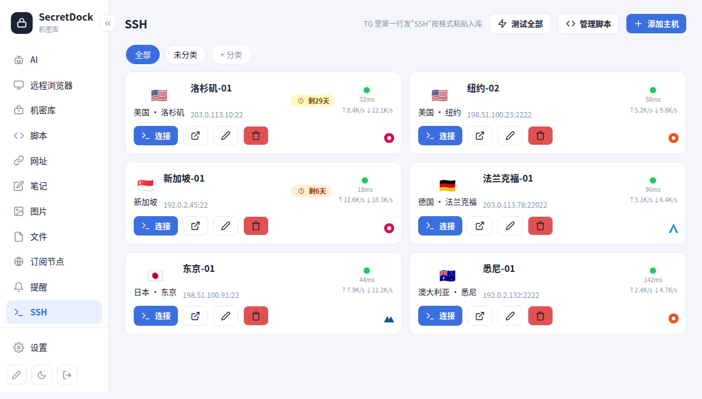

**机密库 / Secrets vault**

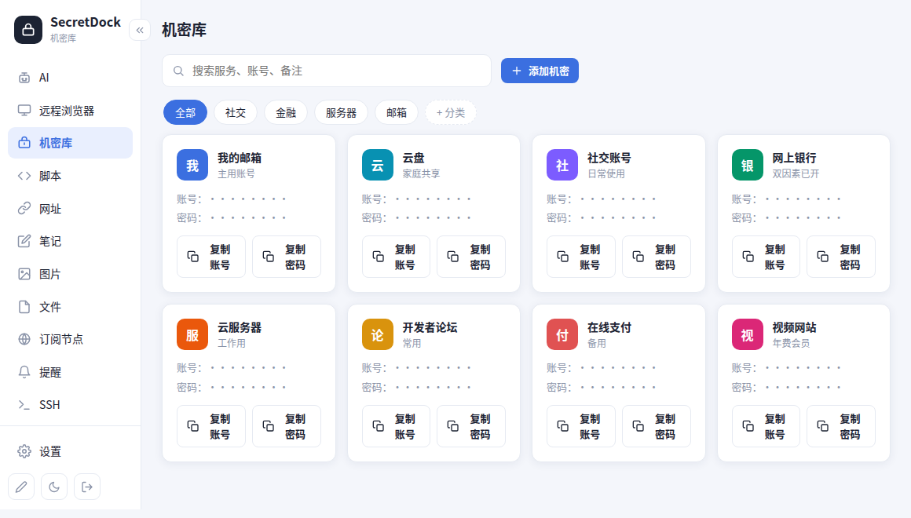

**AI 助手 / AI assistant**

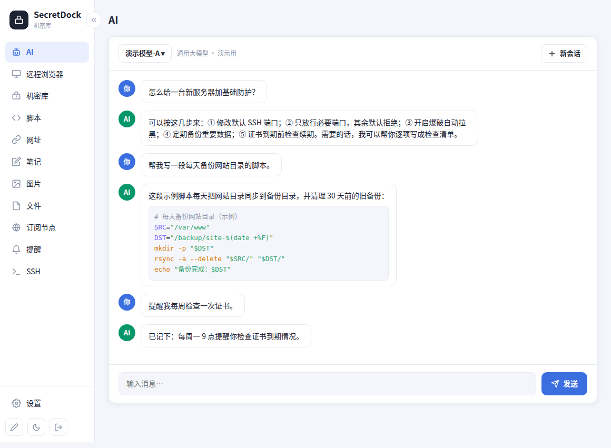

**远程浏览器 / Remote browser**

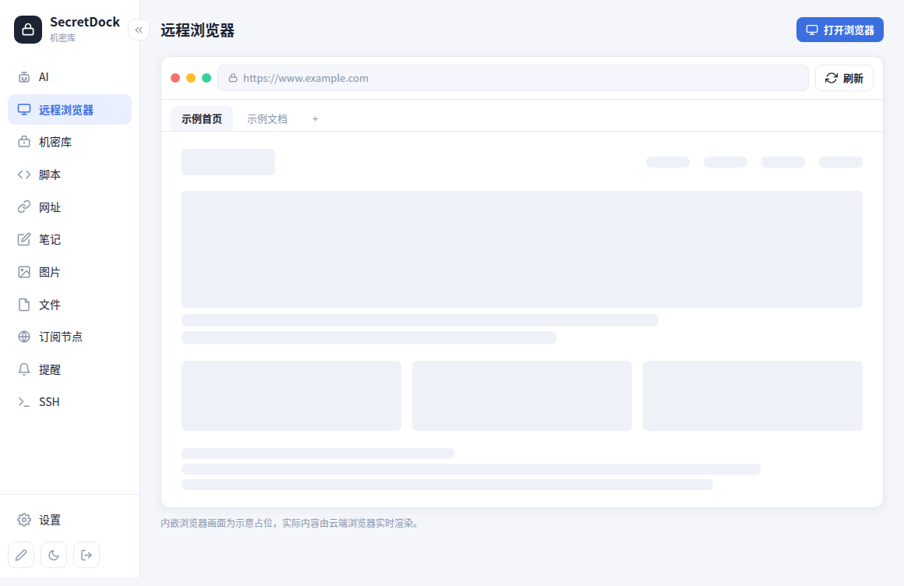

**脚本 / Scripts**

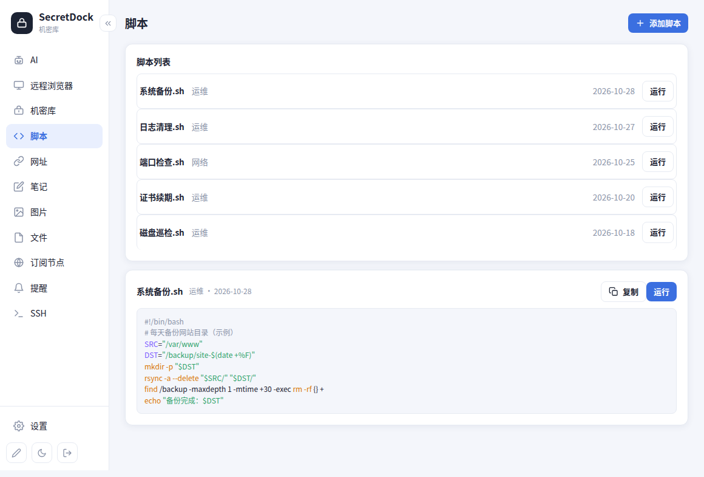

**网址 / Links**

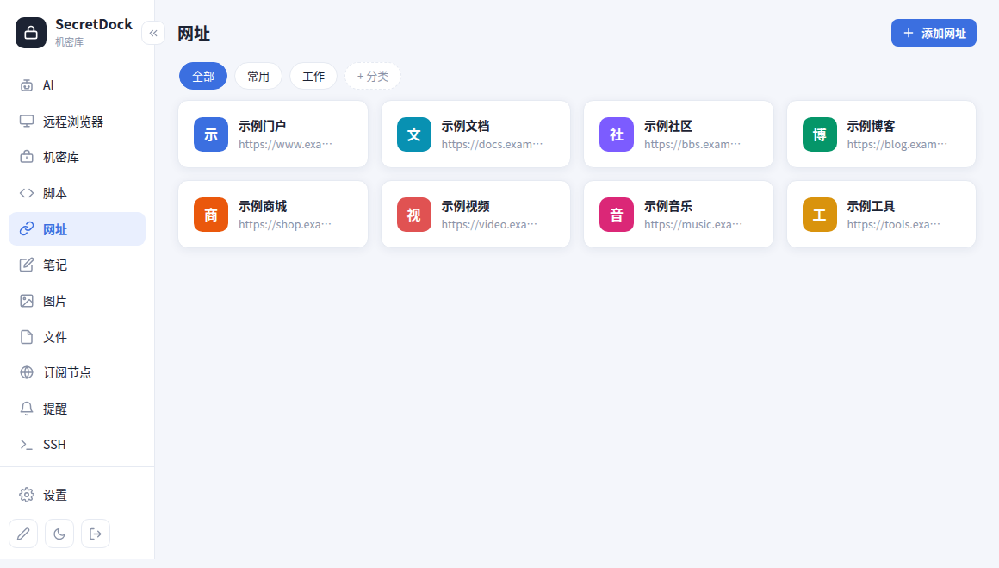

**笔记 / Notes**

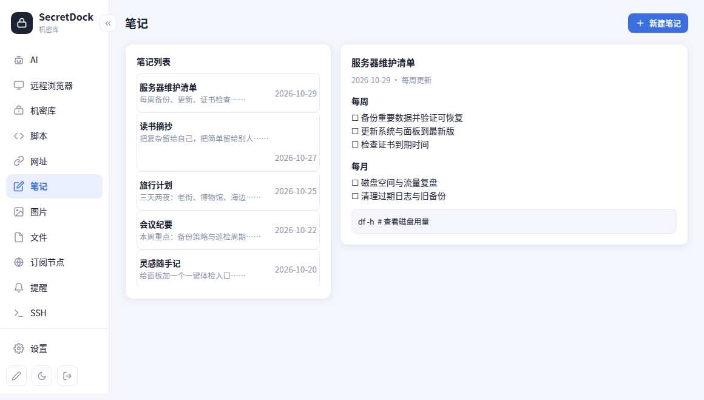

**图片 / Images**

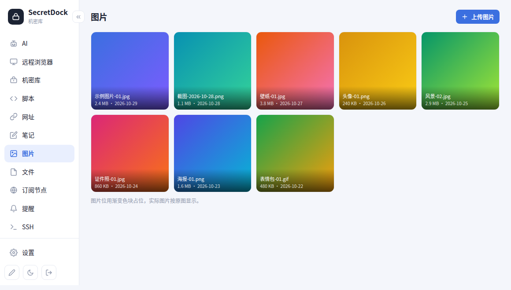

**文件 / Files**

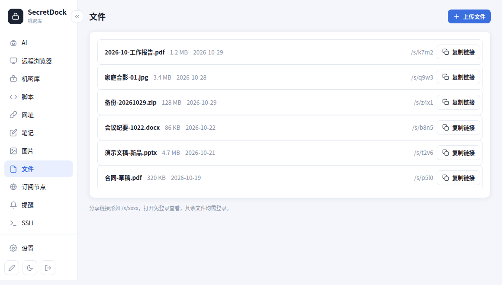

**订阅节点 / Node subscriptions**

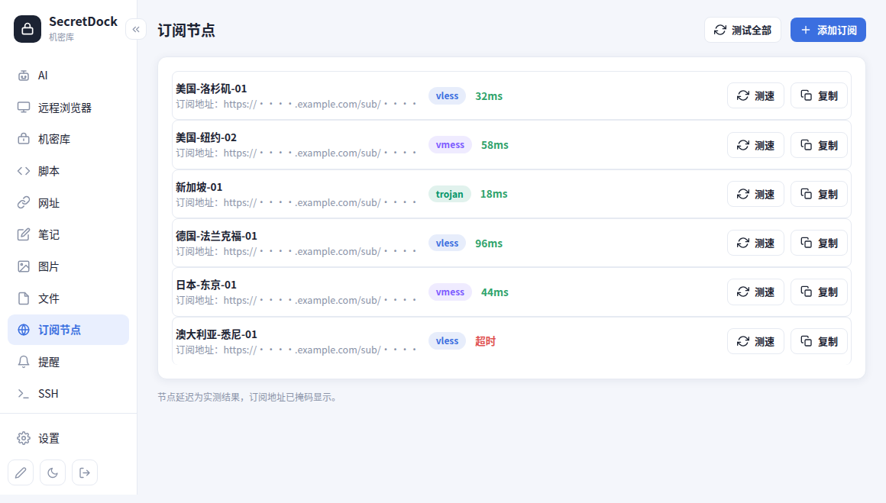

**提醒 / Reminders**

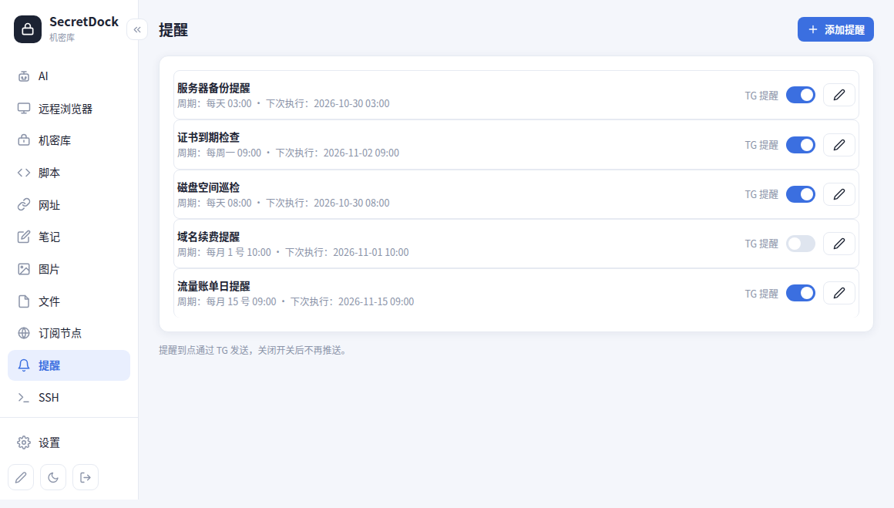

**设置 / Settings**

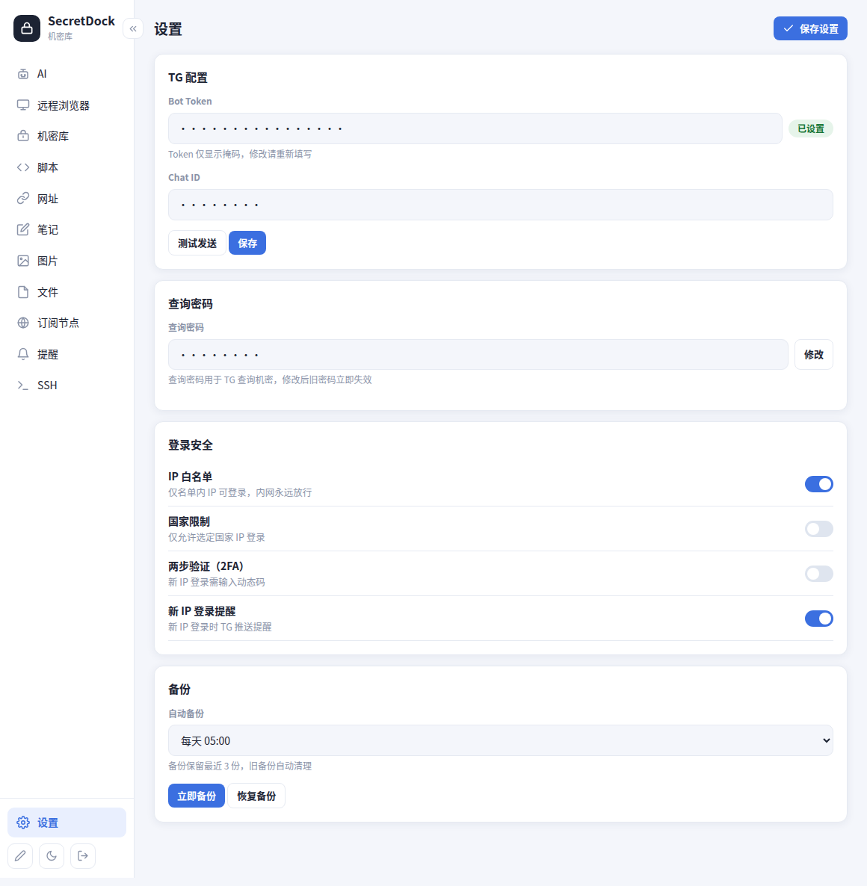

---

## English

SecretDock is a self-hosted secret manager for developers and power users. The fastest way to save anything is through Telegram — just send it to the bot. Manage your servers via SSH right from the browser. Everything is encrypted, and everything stays on your server.

### ✨ Features

**🔐 Secrets Vault**
- Two types: account credentials & API secrets
- Auto-grouping by service name, with logo recognition
- Expiry reminders, pin to top, smart search

**📜 Scripts** — Store userscripts, Surge/Loon rules, with syntax highlighting and one-click copy

**🔗 Links** — Bookmark manager with auto title fetching and link preview

**📝 Notes** — Markdown notes with live preview, toolbar, and categories

**🖼️ Images / 📁 Files** — Upload, organize, and share via secure expiring links (`/s/xxxx`)

**🖥️ SSH Manager** — Connect to your servers right from the browser (web terminal + SFTP file browser)
- Password & key-based login (private keys encrypted at rest, passphrase supported, password fallback)
- One-click script library: categorized install / benchmark / network scripts — click to paste into the terminal, never auto-runs; fully editable
- **VPS expiry radar**: set an expiry date per host and get color-coded badges (yellow ≤30d, orange ≤7d, red ≤3d / overdue), one-click renew with smart next-date suggestions (+1/+3/+6 months, +1 year), and tiered Telegram alerts (30/7/3/1 days, on the day, then daily while overdue) until you mark it renewed
- Optional vendor console link per host, one click from the host card

**📡 Node Subscriptions** — Parse and test proxy subscription links (vless/vmess/trojan/ss/hysteria/tuic/wireguard…)

**⏰ Reminders** — Schedule recurring notifications via Telegram

**🤖 AI Assistant** — Multi-provider AI chat built in (any OpenAI-compatible API), with web search, conversation search, and image/video generation saved straight into your vault

**🌐 Remote Browser** — A full cloud browser (neko) embedded in the web UI, for browsing from your server

**🤖 Telegram Bot** — The killer feature:
- **Add** secrets/scripts/links/notes/images/files by simply sending them to the bot
- **Query** secrets: send a service name, verify with your query password, get credentials instantly (auto-deletes after N minutes)
- **Security alerts**: login notifications with one-click IP ban

### 🔒 Security

- **AES-256-GCM** encryption for all sensitive data, with a server-side master key
- **Argon2id** password hashing (OWASP recommended)
- **Login Security** (optional): country allowlist, IP whitelist/blacklist, TOTP 2FA
- **Session IP check**: sessions are invalidated if the client IP changes (defense in depth)
- **Brute-force protection**: progressive lockout (3 → 5 → 10 min → … → permanent)
- **TG query protection**: separate query password, auto-ban on too many failures
- **No tracking, no telemetry, no cloud** — your data never leaves your server

### 🚀 Quick Start (Docker)

**One-liner (fastest — installs Docker if missing)**

```bash
curl -fsSL https://raw.githubusercontent.com/pal537/SecretDock/main/install.sh | bash
```

**Option A: Prebuilt image (Docker already installed)**

```bash
docker run -d --name secretdock \
  -p 127.0.0.1:8080:8080 \
  -v ./data:/data \
  --restart unless-stopped \
  pal537/secretdock:latest
```

**Option B: Build from source**

```bash
git clone https://github.com/pal537/SecretDock.git
cd SecretDock
docker compose up -d --build
```

Open `http://localhost:8080` — you'll see the setup page. Create your admin account (one time only), and you're in.

All data lives in `./data/` (database, images, files, and the master key). Back up this directory for disaster recovery — but store the backup securely, as it contains the decryption key. For off-site backups, use the encrypted backup feature in Settings (password-protected).

For HTTPS in production, put nginx or Caddy in front. See [DEPLOY.md](DEPLOY.md) for details.

---

## 中文

SecretDock 是一个自托管的机密管理器，为开发者和重度用户打造。最方便的是随手录入：直接把内容发给 Telegram 机器人就入库了。在浏览器里就能 SSH 管理服务器。所有数据加密存储，不出你的服务器。

### ✨ 功能

**🔐 机密库**
- 两种类型：账号密码 & API 密钥
- 按服务商自动分组，LOGO 自动识别
- 过期提醒、置顶、智能搜索

**📜 脚本** — 存储油猴脚本、Surge/Loon 规则，语法高亮，一键复制

**🔗 网址** — 书签管理，自动抓取标题，链接预览

**📝 笔记** — Markdown 笔记，实时预览，工具栏，分类管理

**🖼️ 图片 / 📁 文件** — 上传整理，通过安全分享链接分享（`/s/xxxx`）

**🖥️ SSH 管理** — 直接在浏览器里连服务器（网页终端 + SFTP 文件管理）
- 密码 + 私钥登录（私钥加密存储，支持口令，密码兜底）
- 一键脚本库：装机/测速/线路等分类脚本，点一下粘贴进终端（不自动回车），可自由增删改
- **VPS 到期雷达**：给每台主机设到期日，卡片上分级徽章提醒（≤30 天黄 / ≤7 天橙 / ≤3 天及过期红，只显示标记不显示日期）；点徽章一键续费（按上次周期自动建议新日期，+1/+3/+6 个月、+1 年快捷选择）；TG 在 30/7/3/1 天、到期当天分级提醒，过期后每天提醒，直到你确认续费
- 每台主机可填商家控制台链接，卡片上一键直达

**📡 订阅节点** — 解析测试代理订阅链接（vless/vmess/trojan/ss/hysteria/tuic/wireguard…）

**⏰ 提醒** — 定时 Telegram 推送提醒

**🤖 AI 助手** — 内置多商家 AI 对话（任意 OpenAI 兼容接口），支持联网搜索、会话搜索，图片/视频生成自动转存进库

**🌐 远程浏览器** — 内置远程浏览器（neko），在网页里开一个跑在服务器上的完整浏览器上网

**🤖 Telegram 机器人** — 核心功能：
- **录入**：直接把内容发给机器人，自动识别分类入库
- **查询**：发服务商名，验证查询密码，秒回凭证（N 分钟后自动删除）
- **安全提醒**：登录通知，TG 内一键封禁可疑 IP

### 🔒 安全性

- **AES-256-GCM** 加密所有敏感数据，服务器端主密钥管理
- **Argon2id** 密码哈希（OWASP 推荐）
- **登录安全**（可选）：国家白名单、IP 黑白名单、TOTP 双因素认证
- **会话 IP 检查**：客户端 IP 变化时会话失效（纵深防御）
- **防暴力破解**：渐进式锁定（3次→5分钟→…→永久）
- **TG 查询保护**：独立查询密码，错误过多自动封禁
- **无追踪、无遥测、无云端** —— 数据不出你的服务器

### 🚀 快速开始（Docker）

**一键安装（最快，缺 Docker 会先装 Docker）**

```bash
curl -fsSL https://raw.githubusercontent.com/pal537/SecretDock/main/install.sh | bash
```

**从源码构建**

```bash
git clone https://github.com/pal537/SecretDock.git
cd SecretDock
docker compose up -d --build
```

打开 `http://localhost:8080` —— 看到初始设置页，创建一个管理员账号（仅一次），即可使用。

所有数据都在 `./data/` 目录下（数据库、图片、文件、主密钥）。备份这个目录可做灾难恢复 —— 但备份文件务必妥善保管，因为它包含解密钥匙。异地备份请用设置里的加密备份功能（密码保护）。

生产环境请用 nginx 或 Caddy 做 HTTPS 反代，详见 [DEPLOY.md](DEPLOY.md)。

---

## 📄 License

MIT
